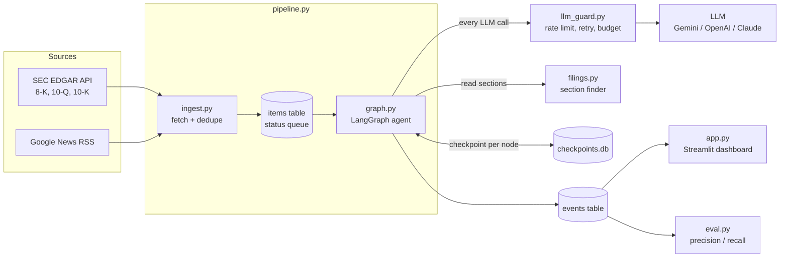
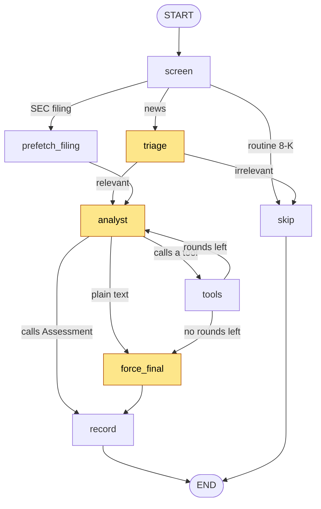
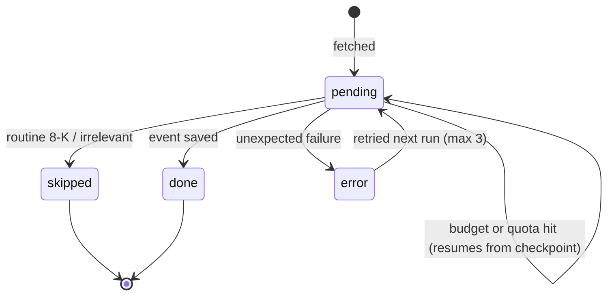

# Credit Monitor Agent

**An agentic AI tool that screens SEC filings and news for bond issuers and flags events that
could change their credit risk, with a severity score and a written rationale.**

Built with Python, LangGraph, LangChain, Pydantic, SQLite and Streamlit.

---

## The problem

Asset managers lend money to companies by buying their bonds. A credit analyst has to know, at
all times, whether each of those companies can still pay the money back. One analyst may cover
30–50 issuers, and every day brings new SEC filings and hundreds of headlines. Most of it is noise,
but one sentence about a covenant breach or a liquidity squeeze can cost millions if it's missed.

## What this tool does

It acts as a **first-pass screener**, like a junior credit analyst:

1. **Collects** recent SEC filings (8-K, 10-Q, 10-K) and news headlines for a watchlist of issuers.
2. **Filters** the noise: routine filings are skipped by rule; headlines get one quick AI check.
3. **Investigates** what's left: an agent reads the credit-relevant sections of the filing and
   decides whether it needs more evidence.
4. **Judges** each event from a bondholder's perspective: event type, direction, severity 1–5,
   a summary for the portfolio manager, and its reasoning.
5. **Shows** the results on a dashboard, with the evidence and the steps the agent took.

**Example.** Ford filed an 8-K about a short-term supplier problem that paused some F-150
production. The agent read the filing, saw the cost fit within Ford's existing earnings guidance,
and rated it *neutral, severity 1*.

---

## Architecture

### System overview



### The agent graph


*Yellow nodes call the LLM; the others are plain Python.*

| Node | LLM call? | Job |
|---|---|---|
| `screen` | — | Routes by source. 8-Ks that only report routine items (shareholder votes, exhibits) are skipped by rule. |
| `triage` | 1 | News only: *could this affect the issuer's ability to repay debt?* |
| `prefetch_filing` | — | Filings only: reads the liquidity, debt and risk-factor sections. Skips triage, since a title like "10-Q filed" tells the model nothing. |
| `analyst` | 1 per round | Decides: read another filing section, check recent news, check issuer history, or submit the `Assessment`. Max 3 tool rounds. |
| `tools` | — | Runs the requested tools and records what actually ran. |
| `force_final` | 1 | Fallback when the model answers in plain text or runs out of rounds. |
| `record` | — | Builds the final `CreditEvent`. `checked_filing` is set from what ran, not from the model's claim. |

### Item lifecycle



### Design decisions

| Decision | Why |
|---|---|
| **Explicit LangGraph graph** instead of a prebuilt agent | Control over routing and cost, every step visible, checkpoint-level resume. |
| **Section-aware filing reader** | The first version read the first 15,000 characters, about 8% of a 10-Q and mostly the table of contents. Credit information lives in Liquidity, Debt and Risk Factors. |
| **Every LLM call goes through a guard** | Runs on a free key (~20 calls/day): spacing, retries with exponential backoff, per-run budget, clean stop on daily quota. |
| **SQLite checkpointer, one thread per item** | A run that stops mid-item resumes at the failed node; finished LLM calls are never repeated. |
| **Item status, saved in one transaction** | An item is only `done` once its event is saved, so nothing is lost on a crash. |
| **System-recorded facts** | `checked_filing` and filing coverage come from what the code did, not from what the model says. |
| **Untrusted-text wrapping** | Filing and news text is tagged as data; the model is told never to follow instructions inside it. Tools are read-only. |
| **Pydantic structured outputs** | Results are validated (e.g. severity must be 1–5), queryable and measurable. |
| **Dependency injection** | The LLM and data sources are passed in, so tests run with a fake LLM and no network. |

---

## Project structure

```
Credit-Monitor-Agent/
├── pipeline.py        # Entry point: fetch, queue, run the graph per item, save results
├── graph.py           # The LangGraph agent: nodes, routing, tools, checkpoint resume
├── filings.py         # Filing text extraction, section finder, coverage, untrusted wrapper
├── llm_guard.py       # Rate limiting, retries with backoff, run budget, quota detection
├── ingest.py          # SEC EDGAR + Google News fetching, 8-K item labels, dedupe IDs
├── db.py              # SQLite storage, item status lifecycle, schema migration
├── schemas.py         # Pydantic models: Triage, Assessment, CreditEvent, tool arguments
├── config.py          # Watchlist and all settings (overridable in .env)
├── app.py             # Streamlit dashboard
├── eval.py            # Triage precision / recall against hand labels
├── tests/             # Offline tests with a fake LLM (no API key, no network)
├── docs/
│   ├── explain-the-graph.md   # 2-minute walkthrough + likely questions
│   └── glossary.md            # Credit and AI terms used in this project
├── requirements.txt
└── .env.example
```

---

## Getting started

**Requirements:** Python 3.11+, a free API key (Gemini works).

```bash
git clone https://github.com/hamzajunaid1712269/Credit-Monitor-Agent.git
cd Credit-Monitor-Agent
pip install -r requirements.txt
cp .env.example .env          # Windows: copy .env.example .env
```

Fill in `.env`:
```
GOOGLE_API_KEY=your-key        # free at aistudio.google.com
MODEL=google_genai:gemini-3.8-flash
SEC_USER_AGENT=Your Name your.email@example.com
```

Run:
```bash
pytest -q                          # offline tests, no API calls
python pipeline.py --dry-run       # fetch and list the queue, no LLM calls
python pipeline.py --tickers F     # process the queue within this run's budget
python pipeline.py --no-fetch      # later: continue the queue without fetching again
streamlit run app.py               # open the dashboard
```

On a free key, a run processes a few items and then stops with *"Progress is saved"*.
Run it again later to continue where it stopped.

### Configuration
All settings live in `config.py` and can be overridden in `.env`:

| Variable | Default | Meaning |
|---|---|---|
| `MODEL` | `google_genai:gemini-3.8-flash` | Any LangChain `provider:model` string |
| `LLM_MIN_INTERVAL` | `12` | Seconds between LLM calls |
| `LLM_MAX_CALLS_PER_RUN` | `18` | Stop cleanly after this many calls |
| `LLM_MAX_RETRIES` | `4` | Retries for timeouts and per-minute limits |
| `MAX_TOOL_ROUNDS` | `3` | Max tool rounds per item |
| `FILING_CHAR_BUDGET` | `14000` | Max filing characters sent to the model |

---

## Evaluation

```bash
python eval.py export     # writes labels.csv
# label the human_relevant column with 1 / 0
python eval.py score      # prints accuracy, precision, recall
```

- **Precision:** of the items flagged, how many mattered. Low precision wastes analyst time.
- **Recall:** of the items that mattered, how many were caught. In credit, recall matters most,
  because a missed warning is expensive.

*Results will be published here once the labelled set is complete.*

---

## Roadmap

### Done
- [x] Data ingestion from SEC EDGAR and Google News, with deduplication
- [x] Triage + tool-using analyst agent with structured outputs
- [x] SQLite storage and Streamlit dashboard
- [x] Rebuilt the agent as an explicit LangGraph graph with routing
- [x] SQLite checkpointer: resume a stopped item at the failed node
- [x] Free-tier survival: spacing, retries with backoff, run budget, quota detection
- [x] Item status lifecycle; fixed items being lost after a failed analysis
- [x] Section-aware filing reader with coverage tracking
- [x] Routine 8-Ks skipped by rule (zero LLM calls)
- [x] Untrusted-text wrapping for filings and news
- [x] Offline test suite with a fake LLM

### Next
- [ ] **RAG over filings:** chunk and embed filings in a vector store (Chroma); give the agent a
      `search_filings(query)` tool instead of heading search
- [ ] **Prompt-injection guard:** detect and flag hostile text in filings
- [ ] **Evaluation set:** ~100 hand-labelled items, published precision/recall and severity agreement
- [ ] **CI:** pytest on every push with GitHub Actions
- [ ] **FastAPI service:** trigger runs and query events over HTTP
- [ ] **Docker:** one-command setup, image built in CI
- [ ] **Tracing / observability:** per-node timing, token use and tool calls
- [ ] **Human review:** severity 4–5 events wait for analyst approval before alerting
- [ ] **MCP server:** expose the tools to Claude Desktop and other MCP clients
- [ ] **Alerts:** daily scheduled run with email / Slack / Telegram alerts (n8n)

### Later
- [ ] Read 8-K press releases (exhibit 99.1)
- [ ] Full article text for news, not only headlines
- [ ] European issuers (Bundesanzeiger) and rating-agency press releases
- [ ] Bond price moves as a second signal
- [ ] Deployment: k3s, Terraform, Ansible

---

## Limitations
- News is headline-only.
- Section finding is heading-based; unusual filing layouts may be missed (RAG is the planned fix).
- Severity is the model's judgement and is not yet calibrated against analyst labels.
- This is a research and portfolio project, not investment advice.
